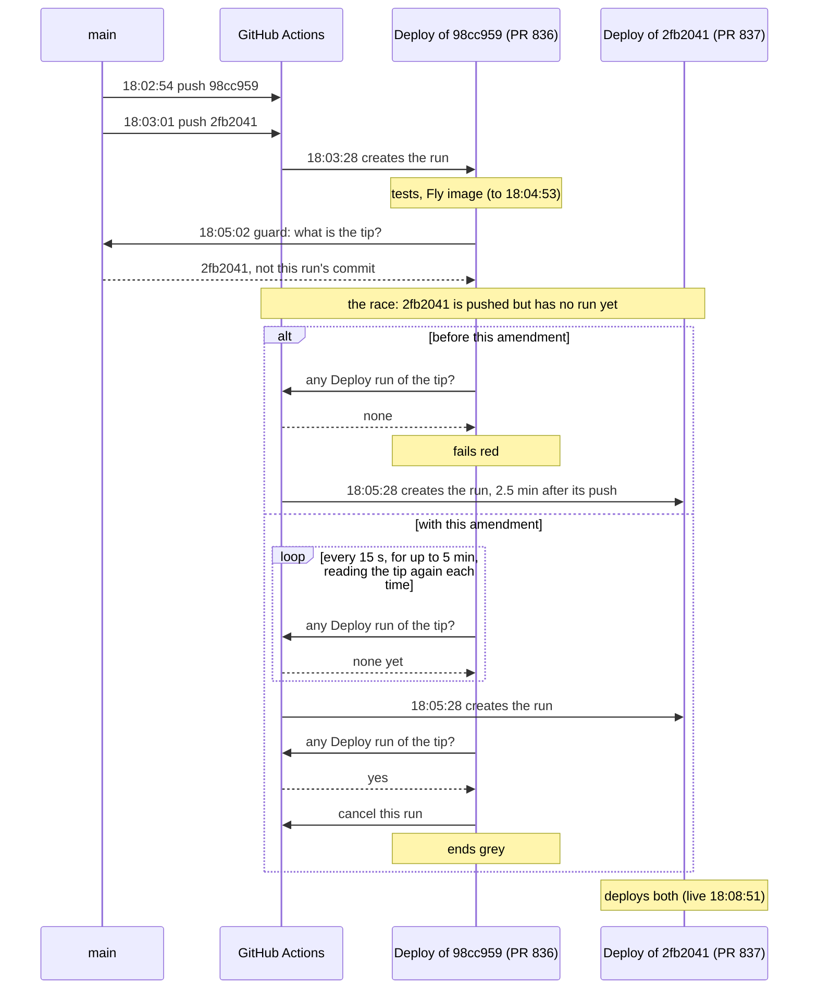

# 024 — Deploys gate on the full test suite, verify themselves, and alert by issue

**Status:** accepted · **Decided:** 2026-08-04 · **Amended:** 2026-10-12, 2026-10-31

## Context

`deploy.yml` fires on push to `main` and, before this decision, ran only `npm run build`
before mutating production. The verification suite — type-drift check, unit tests, infra
tests — lived exclusively in `build.yml` on `pull_request`. Three gaps followed:

- **The merge commit was never tested.** PR checks run against the PR *head*, not the merge
  result. A PR green in isolation can break `main` on merge, and the first thing that happens
  to that merge commit is a production deploy.
- **Nothing required the PR checks anyway.** `main` had no branch protection and no ruleset
  (`gh api repos/salish-sea/salishsea-io/rulesets` returned `[]`). Any push reaching `main` by
  any route deployed with zero test verification.
- **Failure was silent.** `smoke.yml` ran *after* the deploy via `workflow_run` and was gated
  on `github.event.workflow_run.conclusion == 'success'`, so a failed deploy — exactly when
  production is most likely to be half-updated — produced a *skipped* smoke run and no signal
  at all. Two such skips occurred on 2026-08-04. Even a genuine smoke failure only turned a
  separate workflow red; nothing was filed, nothing notified.

The deploy sequence is also unrepeatable and non-atomic: Edge Function → `supabase db push`
→ S3 sync → CloudFront invalidation → `cdk deploy`, with no transaction around it. A
mid-sequence failure leaves the schema ahead of a stale frontend, or a new frontend against
an old edge handler.

## Decision

**One suite, run wherever code can reach production.** `build.yml` gains a `workflow_call`
trigger and `deploy.yml` calls it as a `test` job that the `deploy` job depends on. The gate
is the same workflow PRs run, pointed at the commit actually being deployed, so it covers
merge commits, direct pushes, and re-runs alike — without a second definition to drift.

**Post-deploy verification inside the deploy run.** `smoke.yml` likewise becomes callable and
is invoked as a `smoke` job after `deploy`, replacing the `workflow_run` trigger. A production
that doesn't answer correctly now fails the deploy run itself. It also checks out the deployed
commit rather than whatever the default branch had become by then. The daily schedule and
manual dispatch are unchanged.

**Alerting by labeled issue**, following [003](003-dwc-export-pipeline.md) and
[012](012-ingest-heartbeat.md): a failure opens or updates a single `deploy-failed` issue
naming which job failed and whether production was touched; the next fully green deploy
comments and closes it. One channel for all three of this repo's automated alarms.

**Alerts are suppressed when the run has been superseded *and changed nothing*.** *Since
the [2026-10-31 amendment](#amendment-2026-10-31--an-overtaken-run-ends-cancelled), the older
of two merges in quick succession cancels itself at the `require-current-tip` guard rather
than failing, and the alert job skips a cancelled run; the rule below still covers a
superseded run that fails, such as one whose tests fail.* ~~Two merges
in quick succession make the older run fail the `require-current-tip` guard by design
(gotcha 3 in the runbook).~~ That failure is expected and self-correcting, so the alert job
re-asks "is this run's commit still the tip of `main`?" and stays quiet if not — but only
while the run never got past the deploy job's first remote change. The deploy job sets a
`mutation_started` output immediately before that point; once it is set, a failure has left
production in some half-updated state that the newer run behind it is not guaranteed to
repair, and the alert fires regardless of supersession.

## Rejected alternatives

- **Branch ruleset with required checks + merge queue.** A merge queue does test the merge
  result, which is the textbook fix for the first gap. Rejected as the *primary* mechanism
  because it is repo configuration rather than reviewable, reviewed code — invisible in the
  tree, easily lost, and untestable in a PR — and because it leaves the direct-push path
  depending on that same configuration being right. The in-repo gate covers every route on
  its own. A ruleset remains worth adding as defense in depth; it is not load-bearing here.
- **Automatic rollback on smoke failure** (re-sync S3 from the previous artifact and
  invalidate). Rejected: `supabase db push` is forward-only, so reverting the frontend alone
  points old code at an already-migrated schema — frequently worse than the failure being
  rolled back, and worse in a way that is harder to reason about at 2am. Recovery is fix-
  forward, and the alert says so explicitly.
- **Keeping the gate on PRs only and trusting review.** This is what was in place; it is what
  the issue is about.
- **A separate, deploy-specific test workflow.** Two definitions of "verified" drift apart,
  and the cheaper one wins.

## Consequences

- Every deploy costs the suite up front — a few minutes, dominated by `supabase db start`.
  Deploys are serialized (`concurrency: deploy-production`), so that time is also queue time
  for anything merged behind it. Accepted: the sequence it guards cannot be taken back.
- The smoke job runs inside the deploy run and therefore inside the concurrency group, so the
  next deploy waits until this one is verified rather than merely shipped. Intended.
- An open `deploy-failed` issue means a run failed and no green one has followed. It states
  in its own body whether production was touched, because a gate failure and a half-finished
  deploy are the same colour in the Actions tab and very different at 2am.
- A deploy can now fail for a reason production never sees (a test failure), and that failure
  files an issue saying production was untouched. The gate working looks like a red run.
- Smoke checking out the deployed commit is a small loss against one specific hole. The old
  `workflow_run` trigger checked out the default branch, so it incidentally compared
  production against `main` and could notice a deploy that shipped *stale* content (the
  "`main` advances during the deploy" hole in the runbook's gotcha 3). It now verifies what
  this run shipped, which is the question a post-deploy check should answer. The stale case is
  covered instead by the newer run deploying behind it and by the daily scheduled smoke run,
  which still checks out `main`.

## Amendment, 2026-10-06 — a lost deployment is watched for, not timed out

GitHub sometimes loses a job's deployment to the `production` environment, and the job then waits indefinitely for approval nobody can give. Serialized deploys (`cancel-in-progress: false`, kept) turn that into `main` not deploying at all, silently: twice on 2026-10-06, about three hours each (`salish-t3g.11`). A **Watch** job in the run, bound to no environment itself, treats fifteen minutes without a runner as lost. It waits for anything in flight, files the `deploy-failed` issue, dispatches one fresh run of `main` when the run holds the tip, and cancels the run. Details: [runbook gotcha 4](../runbook/deploys.md#gotcha-4--a-deploy-stuck-waiting-holds-every-later-one).

Rejected: `timeout-minutes`, because it counts from when a runner takes the job, and a lost job never gets one. Also rejected: `cancel-in-progress: true`, because it would interrupt a healthy deploy mid `supabase db push` whenever a newer commit merged, the hazard serializing exists to avoid. Also rejected: an external scheduled check that `main`'s tip deployed. GitHub's cron runs a median 68 minutes late (measured for `ingest-heartbeat.yml`), and a check outside the run could see the stall but not clear it.

## Amendment, 2026-10-12 — the sequence the gate guards has changed

The test gate, the smoke job inside the run, the `deploy-failed` issue and its silence for superseded runs all stand. A deploy now builds the Fly image beside the tests, deploys the CDK stacks, then switches the Fly app to the new image ([`fly/deploy.sh`](../../fly/deploy.sh), [066](066-a-deploy-takes-the-build-lock-and-the-machine-stops-its-writers.md)). There is no Edge Function step, no `supabase db push` and no S3 sync, because Postgres and the S3 site are retired, and the suite has started no database since #669. Rolling back means switching the Fly app to an earlier image ([runbook](../runbook/deploys.md)). The nightly archive workflow cited below as the alert channel's precedent retired on 2026-10-04 ([061](061-ingest-and-derivation-move-into-the-build.md)); the link is to its last version.

## Amendment, 2026-10-31 — an overtaken run ends cancelled

When two merges land close together, the older merge's run used to end red. It reached the superseded-commit guard after the newer merge had moved `main`, and failed, although the run of the newer commit, queued behind it, deploys both, or fails red itself if it can't. The alert job already kept quiet about it, but the red mark stayed in the Actions tab and on the commit, where it looked like a broken deploy (2026-10-31: `a109868`, from #810, overtaken by #811's merge).

Now the guard tells the two cases apart. On a first attempt, if a Deploy run of the newer commit exists and wasn't cancelled, the run writes a summary saying so and cancels itself, so it ends grey, and that newer run decides whether the deploy happens: GitHub's own mark for a run that a newer one replaced, and one the alert job already skips. A re-run of an old commit, the rollback this guard was built for, still fails red, as does a moved tip that has no Deploy run of its own, since then nothing is set to deploy it. The guard only ever stops a run before its first change to production, so a cancelled run has changed nothing.

Rejected: ending green with the deploy steps skipped, as PNW Moths does. A green run that did nothing is how the 2026-07-27 rollback went unnoticed. Rejected: leaving it red. Red that needs no action teaches people to ignore red. Rejected: `cancel-in-progress: true`, for the reason above. The rule is shared across Peter's projects in the workbench's `practices/deploys.md`. Issue: `salish-6bkm`.

## Amendment, 2026-11-04 — the guard waits for the newer commit's run

The 2026-10-31 rule assumed that by the time a run is overtaken, the newer commit already has a Deploy run. It need not: GitHub creates a push's run when it gets round to it. On 2026-11-04 #836 and #837 merged seven seconds apart. #837's merge got its run two and a half minutes after the push, and #836's run reached the guard 26 seconds before that, found no run of the newer commit, and failed red (run 41883222594), although #837's run then deployed both. In UTC:

So on a first attempt, a moved tip with no Deploy run yet is given five minutes to get one, checked every 15 seconds, before the run fails. The tip is read again at each check, because a further merge makes GitHub cancel the pending run of the merge before it; the run looked for is the current tip's. A run that appears in time ends grey as before. A re-run still fails at once, and a moved tip with no run after five minutes still fails red, with a summary that says so. The wait costs an idle runner, and holds back nothing that exists yet: the waiting run keeps the `deploy-production` concurrency slot, but only until the newer run appears, which it then cancels itself for within 15 seconds.

The wait applies to each of the guard's two checks, so a run can wait ten minutes in all. A push that starts no Deploy run, such as one marked `[skip ci]`, now costs a deploy it overtakes five minutes before the red it used to get at once. While it waits, a lookup that fails counts as no run yet and a failed read of the tip keeps the last one, so a passing GitHub API error doesn't end the step before it writes its summary, and if `main` is reset to the run's own commit meanwhile, the run deploys it (added after a review of the same change in PNW Moths).

Rejected: a longer wait. Two and a half minutes is the one delay measured; five is twice that, and a run that has waited five minutes for something GitHub hasn't created is better reported than waited on. Issue: `salish-1jxd`.

## Reference

Issue: `salish-ior`. Workflows: [`deploy.yml`](../../.github/workflows/deploy.yml),
[`build.yml`](../../.github/workflows/build.yml), [`smoke.yml`](../../.github/workflows/smoke.yml).
Alert-channel precedent: [`dwca-nightly.yml`](https://github.com/salish-sea/salishsea-io/blob/4cb8ed3121ba1ad3fedf25b0b7038e6d8b36bd5b/.github/workflows/dwca-nightly.yml) (retired 2026-10-04).
Superseded-commit guard: [`require-current-tip`](../../.github/actions/require-current-tip/action.yml),
[runbook gotcha 3](../runbook/deploys.md).
