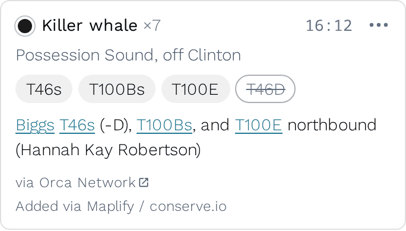
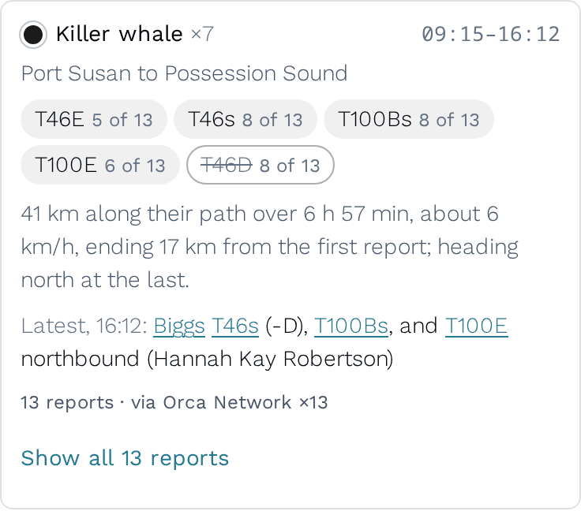

# 109 — A sighting keeps what its text says was absent or only possibly there, and its card shows an absent animal struck through

**Status:** accepted · **Decided:** 2026-11-04, by Peter (the struck-through chip, over leaving the card as it was or adding a line in words) · **Work:** bd `salish-uh38` · **Amends:** [105](105-the-build-and-the-browser-read-sighting-text-with-one-reader.md), [106](106-a-comment-can-name-the-animal-a-sighting-was.md) · **Applies:** [054](054-certainty-is-the-asserters-status-is-ours.md)

## Context

Since [decision 105](105-the-build-and-the-browser-read-sighting-text-with-one-reader.md) the build reads a sighting's text with [`src/sighting-text.ts`](../../src/sighting-text.ts), which answers each code the text names with whether the text says the animal was present or absent, and how sure the reporter was. The build kept only the present codes and threw the rest away. Two things were lost.

**An absent animal was linked to the sighting all the same.** Orca Network writes *Biggs T46s (-D), T100Bs, and T100E northbound* to say that T46D was not with the rest of the T46s. The build linked that sighting to the T46s matriline and, through the matriline, to each of its living members, T46D included. So T46D's page listed a sighting whose reporter said T46D wasn't there. Over the year to 2026-11-04, 60 published sightings name 65 animals as absent, nearly all in this form.

**A hedge was dropped.** *Biggs T37As and possibly T99s* showed T99s exactly as it showed T37As. [Decision 054](054-certainty-is-the-asserters-status-is-ours.md) says a hedge is carried to every consumer and resolved by none of them, and the site already does that for an Orcasound tag. Over the same year, 13 codes were hedged as *possibly* and 87 as *likely*.

## Decision

**A hedge is marked as 054 marks a bout's.** A code the reporter says was only possibly there is written with a trailing `?` among the occurrence's `identifiers` (`T99s?`), as a bout's tag already is. The card's dashed chip, "T99s (possibly)", the map label and the archive's `unvalidatedIdentifiers` already read that mark, so nothing new appears. A *likely* code is written plain: 054 gives the map and the card two states where the data has three, because "probably T99s" is T99s to someone deciding where to look. Where several reports in a travel segment name the same animal, one that names it plainly outranks one that hedges, as 054 says for bouts.

**Each identifier candidate records whether the animal was there and how sure the writer was.** `build.occurrence_identifier_candidates` gains `is_present` and `certainty`. A code the text says was absent is a candidate with `is_present` false: it is a claim about that animal, as [CONTEXT.md](../../CONTEXT.md)'s Identification already allows. `certainty` is `probable` or `possible` for a hedged code and null for a plain mention: the reader calls a plain mention certain, but nobody said so, which is 054's null. The occurrence's document gains `absent`, the list of absent codes, beside `identifiers`.

**An absent animal stays off the sighting's profile links.** The individual links leave out a member the sighting reached only through its matriline when the same sighting names that member as absent; the member's own row says absent, and no page lists an absent row. A population's, a community's or a pod's page doesn't count an absent animal or group at all, since one missing member says nothing about whether its population was there. A hedged candidate reaches the links with its certainty, as a bout's does.

**On iNaturalist, only the observer can say an animal was absent.** An absence in the observer's own comment counts as one in the description (decision 106 already kept such a code out of `identifiers`). An absence in someone else's comment is not read: whoever was there decides who was missing, and a commenter's "not the T90s" is a disagreement for a curator to weigh, which the card already shows (decision 107).

**The card shows an absent animal as a chip, outlined and struck through, after the animals that were there.** It links to the animal's page, as any chip does. Its tooltip says "The report says T46D wasn't with them", and a screen reader, which announces no strike-through, hears "T46D (not with them)". A travel segment's card pools them as it pools the present ones, with how many reports say so: "~~T46D~~ 8 of 13".

**What the rest of the site does with an absence:**

- **The Darwin Core archive leaves it out**, as it did. Darwin Core has no term for one animal missing from a group, and `unvalidatedIdentifiers` lists the codes the text says were present ([rights policy §2.4](../rights-policy.md)). A hedged code keeps its `?` there, as 054 says.
- **An animal's timeline doesn't mention it.** The sighting simply isn't on the absent animal's page.
- **The map label doesn't show it.** A label names who was there.

**Where it lives.** [`derive/occurrences.sql`](../../scripts/read-path/derive/occurrences.sql) writes `identifiers` with the `?`, `absent`, and a column of `build.occurrences` named `claims`: every code the text names, with its presence, its certainty and where it was read. `claims` replaces 106's `identifier_origins`, which held where each present code was read and nothing else. [`derive/identifier-candidates.sql`](../../scripts/read-path/derive/identifier-candidates.sql) reads `claims`, and [`derive/profile-links.sql`](../../scripts/read-path/derive/profile-links.sql) reads the candidates. In the browser, a contributor's own sighting carries the same `?` and `absent` until the build publishes it ([`src/identifiers.ts`](../../src/identifiers.ts)), and the two cards are [`src/obs-summary.ts`](../../src/obs-summary.ts) and [`src/segment-summary.ts`](../../src/segment-summary.ts).

## Rejected

- **Leaving the card as it was**, and using the absence only to fix the profile links. The report's "(-D)" is right under the chips, but the chips are what a reader scans, and "T46s" alone reads as all of the T46s.
- **A line in words under the chips, "Not with them: T46D".** Plainer to someone who doesn't know the shorthand, and to a screen reader without hidden text, but it costs a line on each such card, and it separates the missing animal from the group it was missing from. Peter chose the chip.
- **Writing an absent code into `identifiers` with a mark of its own**, as the `?` is. Every reader of `identifiers` (the map label, the ecotype rule in [`src/segments.ts`](../../src/segments.ts), the archive) would have to learn to skip it, and one that didn't would show the animal as present.

## Not covered

- **A hedged absence**, *T046Bs (-T046B2 ?)*, is read as a certain absence. One such report in the year.
- **Reports that disagree.** If one report in a segment says T46D was there and another says it wasn't, the segment's card shows both chips, each with its count. Nothing reconciles them; that is a curator's call.
