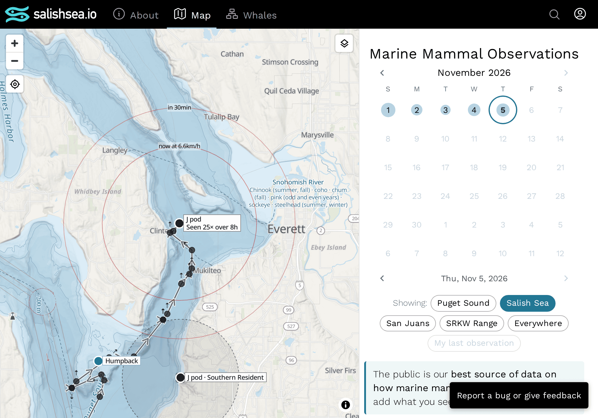

# 115 — The ring around a track's last report is its reach along water

**Status:** accepted; built · **Decided:** 2026-11-06, by Peter · **Work:** bd `salish-2adm` (the water-only direction; heading, better speeds and behaviour stay open) · **Amends:** [103](103-what-a-port-needs-is-where-whales-may-be-next.md) (the "water only" bullet) and [111](111-the-build-decides-a-days-travel-segments-and-the-day-file-carries-them.md) (the day file's rows may carry `reach`) · **Relates:** [113](113-a-leg-that-crosses-land-is-drawn-along-the-water.md), [114](114-a-routed-leg-is-drawn-as-a-smooth-curve-off-the-shore.md)

## Context

[103](103-what-a-port-needs-is-where-whales-may-be-next.md) says what a port needs: our best judgement of where whales might meet vessels in the next half hour. The basic version is the pair of rings the map draws around a track's last report, at the species' travel speed, and the first improvement it names is "water only": clip the ring to water and measure the distance along water, so a group last seen in Haro Strait is not put on San Juan Island.

Today each ring is a circle. A track last seen in Possession Sound on 2026-11-05 gets a circle that covers most of Whidbey Island and the mainland shore, and everything behind the land is as likely, by the picture, as the open water in front. [111](111-the-build-decides-a-days-travel-segments-and-the-day-file-carries-them.md) decided that the browser has no water mask (it is 8 MB, and every visitor would pay for it), so the browser cannot clip the circle itself. The build has the mask.

The difficulty is time. A ring's radius is the speed times the time since the last report, plus half an hour for the second ring, and the browser redraws it every minute. The build runs every five minutes and cannot know the radius the page will want.

## Decision

**The build writes how far it is by water from a track's last report to the sea around it, and the browser draws each ring as a contour of that.** The field is called the report's `reach`.

**The field.** In [`withSegments`](../../scripts/read-path/occurrence-days.ts), the last report of each track of two or more reports gets `reach` when it was seen in the last 6.5 hours (a ring is drawn for six hours, and the farther ring reaches half an hour past that) and its species has a travel speed. The distance is found by Dijkstra's algorithm over the water mask's 90 m cells ([`waterDistanceField`](../../src/sea-distance.ts)), up to the radius the ring could have at 6.5 hours, with each move's length in metres. A report on shore is first moved to the nearest water within 2 km, as the join does. The moves are the eight neighbours and the eight knight's moves, which keeps the distances in open water within about 2% of the straight line, where the eight neighbours alone are up to 8% long, and so would draw a ring that looks like an octagon. A knight's move needs the two cells it passes between to be water, so no move cuts a corner of land.

**Its shape.** The field is sampled on a square window centred on the report, every 500 m, reaching the 6.5 hour radius (179 by 179 samples for an orca at 6.8 km/h), each sample the distance to the 90 m cell it falls in. One byte a sample: the distance in units of 250 m, 254 for farther than 63.5 km, 255 for not reachable (land, or beyond the radius). The row is `reach: {cell: 500, width, height, west, north, values}`: `west` and `north` are the top-left sample's coordinates in degrees to 5 decimals, and `values` is the bytes in base64, row by row from the north. The step in longitude is not written: it follows from `cell` and the window's latitude ([`reachSteps`](../../src/reach.ts)). The field comes after `leg`, last in the row. Nothing is written for an older report, a single report (no ring is drawn for it), a species without a speed, a report outside the mask or far from water, or a build run without `--water-mask`.

**The browser's ring.** [`imputedPositions`](../../src/segments.ts) draws each ring, when the track's last report carries `reach`, as the contour of the field at the ring's radius ([`reachContours`](../../src/reach.ts): marching squares over the samples, linear interpolation between two reachable samples, halfway between a reachable sample and land). The contour is one closed line round the reach, and one more round each island inside it, which is right: the animals cannot be on it. The label is at the northernmost point of the largest loop. Opacity, fading with age, and the six-hour cut-off are unchanged. The `travel` line source does not carry the field; only the rings read it.

**What keeps the circle.** A report without `reach`: a signed-in tab's own unpublished sighting, a day file written before this, a build without the mask. And a report whose own sample is land (a report on shore, moved up to 2 km to water), where no contour encloses the point.

## Rejected

- **A polygon for each radius, written by the build.** The radius is continuous and depends on the clock of the page; the polygons would be many, and still wrong between them.
- **Sending the mask to the browser.** [111](111-the-build-decides-a-days-travel-segments-and-the-day-file-carries-them.md) rejected it for every visitor, and the contour needs no more than distances.
- **A star-shaped ring along bearings** (the farthest water along each of 64 directions). A ray stops at the first land and cannot see round a headland, so the ring's edges cut across headlands and it encloses islands, which is the error this fixes.
- **Only the eight neighbouring moves.** Cheaper, but the ring in open water is up to 8% short on the diagonals and looks like an octagon.

## Consequences

- A recent last report grows by about 43 KB of base64 (an orca at 6.8 km/h; 39.9 KB at 6.6 km/h, 22.9 KB for a humpback, 14.7 KB for a gray whale), 3 to 11 KB once the Fly app's `encode zstd gzip` has compressed it. Only reports of the last 6.5 hours of a track of two or more carry it, so a day file holds a handful, and only today's changes; a report older than that keeps the field until its day file is next rewritten, which is harmless, since the browser draws no ring for it.
- The build spends about 80 to 120 ms on each reach with the fixture mask (the whole Salish Sea mask would be larger, but the search is bounded by the radius), so a build with a few recent tracks takes under a second more.
- The window is square and ends at the radius a ring could have at 6.5 hours, so no ring that is drawn is cut by it. A ring cannot be drawn larger than the window.
- The line is within half a sample (250 m) of the shore where a ring meets land, and the distances are quantised to 250 m: fine for a ring that stands for a guess about speed.
- The ring's other directions in [103](103-what-a-port-needs-is-where-whales-may-be-next.md) are still open: the track's heading, better speeds per ecotype ([`salish-xz0i`](../../src/constants.ts)), and behaviour (`salish-2ua9`). Heading would make the field one-sided and is the next to want a different shape; nothing here prevents it.
- A signed-in tab's own unpublished sighting, and the profile maps, keep drawing circles or nothing, as before.
