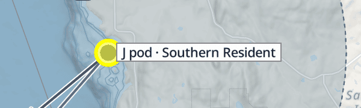
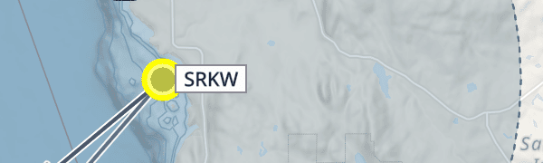
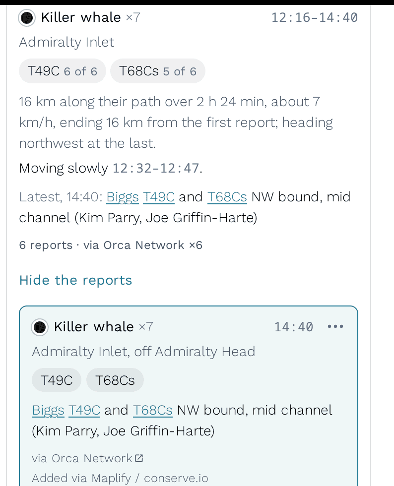
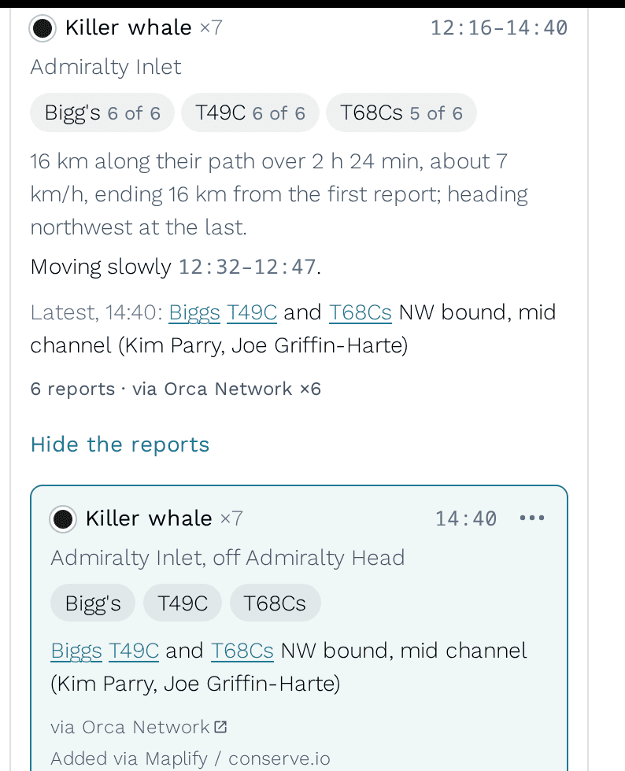

# 121 — A sighting's text names pods and populations in the words a bout's tags use, among its identifiers, and the map label reads only what the build published

**Status:** accepted · **Decided:** 2026-11-25, by Peter (one vocabulary in `identifiers`, over keeping `pods` and adding a `populations` field) · **Work:** bd `salish-gw2r` · **Amends:** [105](105-the-build-and-the-browser-read-sighting-text-with-one-reader.md) (its `pods` key), [029](029-map-symbology.md) (where a label's name comes from) · **Applies:** [054](054-certainty-is-the-asserters-status-is-ours.md), [109](109-a-sighting-keeps-what-its-text-says-was-absent-or-only-possible.md)

## Context

The Orcasound bout of 2026-11-20 at Andrews Bay is titled *Faint SRKW calls, likely J pod* and tagged Southern Resident. The build doesn't read a bout's title: its moderators' tags say who was heard (decision 013). So the day file says `identifiers: ["Southern Resident"]` and `pods: []`, and the card agrees. The map labelled it "J pod · Southern Resident".

The map label had readers of its own. In the browser, `labelForSegment` (`src/symbology.ts`) read each occurrence's text again: `detectPod` for a pod and `detectEcotype`, a regular expression, for *SRKW*, *Biggs* or *transients*. It never looked at what the build had published. So it read titles the build leaves alone, dropped *likely*, and missed what only a record says. Over the year to 2026-11-25, 230 of 5,300 killer whale labels differ from a label made from the published record alone:

- **About 55 labels missed what the record says.** 30 bouts tagged Bigg's and 11 iNaturalist observations naming T codes in a remark were labelled plain "Killer whale". 13 bouts were labelled by a pod in their title that their tags don't name.
- **About 170 labels said what only the text says.** 138 Maplify reports such as *Biggs southbound* under the plain killer whale taxon, and about 30 more saying *SRKW* or *transients*, named a population nowhere in the record, because the shared reader doesn't read population names.

Pods were also split across two lists. A bout's pods are among its `identifiers`, in the register's words ("J pod", "J pod?"); a text's are in `pods`, as letters ("J"), with no hedge. The cards join the two lists back together (`namedInReport`, `src/individual-links.ts`).

## Decision

**The shared reader names pods and populations, as claims, in the register's words.** [`src/sighting-text.ts`](../../src/sighting-text.ts) answers "J and K pods" with the claims `J pod` and `K pod`. It answers *Biggs*, *Bigg's* and *transients* with `Bigg's`, and *SRKW* and *southern residents* with `Southern Resident`. These are the labels the register gives those groups and a bout's tags already carry. Each claim says what kind of name it is: `code`, `pod` or `population`. The readers that want catalogue codes alone, which are the identifier candidates and the gold set's score of codes, take only `code` claims. A pod or a population is found where it is written, as a code is, so a hedge reaches it as it reaches a code: *possibly J pod* is possible, *likely J pod* is probable. A question mark directly after a code, a pod or a population, as in *Js?* or *T65A?*, makes that one name possible and reaches no further. A question mark standing apart still makes the names after it possible, up to the next comma.

**They are written among the occurrence's `identifiers`, as a code is, and `pods` goes.** As decision 109 says, a possible one ends in `?` ("J pod?") and a probable one is plain. A report's identifiers and a bout's then mean the same things in the same words, so the cards, the map label, the rule that joins reports into tracks and the archive each read one list. The document's `pods` key is removed, along with the reader's `pods` and `namedInReport`.

**The map label is made from the published record and nothing else.** `labelForSegment` reads the segment's `identifiers` and taxa:

1. the first pod named (`J pod`), or the pod letter of the first code (`J27` is J pod, `T65A` is Biggs);
2. otherwise a population named (`Bigg's` is Biggs, `Southern Resident` is SRKW);
3. otherwise the taxon, as before: the Southern Resident community is SRKW, `rectipinnus` is Biggs and `ater` is Resident.

The reports are taken in time order, and each one's identifiers in the order its text gives them. A name that any report gives plainly comes before one that is only hedged, as 054 says, so a hedged name is used only when no report gives a name of that step plainly. A name taken from a hedged identifier keeps its `?`: `J27?` alone gives "J pod?". A hedged pod still comes before a plain population: "J pod? · Southern Resident". The `?` that marks a species only possibly there is not added a second time.

The list after the name leaves out what the name already says:

| name | leaves out |
|---|---|
| J pod (K, L) | `J pod`, `J pod?`; and, when the pod is plain, `Southern Resident` and `Southern Resident?` |
| Biggs | `Bigg's`, `Bigg's?` |
| SRKW | `Southern Resident`, `Southern Resident?` |

So the bout above reads "SRKW", not "SRKW · Southern Resident". `detectPod` and `detectEcotype` are removed. A contributor's own sighting, before the build publishes it, gets its identifiers from the same reader, in the text's order as the build writes them (`src/own-occurrence.ts`), so it is labelled by the same rule.

## What changed, measured on production

Over the year of day files to 2026-11-25, 68 of 5,300 killer whale labels change. Those that said only what the text says keep their label, because the reader now reads population names.

| from | to | count | example |
|---|---|---|---|
| Killer whale | Biggs | 43 | a bout tagged Bigg's, *Intense Bigg's signals* |
| J pod | SRKW | 11 | a bout tagged Southern Resident, titled *J pod NB Andrews Bay* |
| Biggs | Biggs? | 5 | *possibly T46s* |
| SRKW | J pod | 3 | a bout tagged J pod, titled *SRKWs SB near Kelp Reef* |
| Resident | J pod | 3 | an iNaturalist observation whose remark names J pod |
| other | | 2 | *J pod and K pod northbound, Ks here* is now J pod, the first named |

A report that hedges a name and later states it plainly keeps it plain: *possible Southern Residents but unconfirmed … EDIT: Confirmed SRKWs* is SRKW.

The bout this record began with, before and after:

A report's card now shows the population its text names, as a bout's card already did. The same Maplify report, *Biggs T49C and T68Cs NW bound*, before and after:

Over the year, 1,521 killer whale reports gain such a chip. Three reports of other species name a population, each about killer whales hunting them (*Hunted down by transient orcas*), and show it as they already show any T code their text names.

## What else changes

- **The archive's `unvalidatedIdentifiers`** gains the pods and populations a text names, as it already has a bout's.
- **The rule that joins reports into tracks** (`ecotypesOf`, `src/segments.ts`) already reads "J pod" and "Bigg's" among identifiers. A report that says only *Biggs* now names an ecotype, so it no longer joins a resident track. A hedged population counts, as a hedged code (`T65A?`) already does. The hand-labelled days ([118](118-the-join-rule-is-measured-against-hand-labelled-days.md)) show what that changes, for review.
- **The identifier candidates** take a text's pods and populations as well as its codes, so a report that says *J pod* is on J pod's page, as a bout tagged J pod already was. Each kind is tried only against its own lookup, so "Bigg's" is never taken for a matriline. A pod claim is matched by the register's fold to the pod's letter plus " pod" ("J pod" to the pod whose designation is J). A population claim is matched to the designation of an ecotype or community ("Bigg's", "Southern Resident"). A claim that matches no group stays a candidate with no id, as an unmatched code does. The profile links treat it as they treat a bout's tag of that group: the group's page and the pages of the populations above it, never its members'. Over the year to 2026-11-25, this adds to J pod's page about 510 reports, to K pod's 409 and to L pod's 27, which name the pod in words and no animal under it. The Southern Resident page gains those through its pods, and 187 more that say only *SRKW*. The Bigg's page gains 190 that say *Biggs* and no T code. ~~They keep `code` claims only. A pod or a population named in a text doesn't reach that page's sightings in this change. A bout's tags do, through another path (`derive/profile-links.sql`). Making a text's reach the page too is bd `salish-wgv9`.~~ *Amended 2026-11-25 (bd `salish-wgv9`), for consistency with a bout's tags.*
- **The day files written before this change** carry `pods` and no pod among their identifiers. A change to the build's code makes its next run rewrite every day, and the site serves day files `no-cache`. So an old file can meet the new page only in the minutes between a deploy and that run, and nothing reads the old key.

## Rejected

- **Keeping `pods` as its own field, with a `?` for a hedged pod, and adding a `populations` field.** It touches fewer consumers, but every reader of a report's names would merge three lists. That is the duplication this record removes.
- **Keeping `detectEcotype` for the label alone.** The label would go on saying things that the card, the archive and the join rule don't know.
- **Reading a bout's title.** Its tags are the moderators' considered identification. The title is a note, often written before the tags are set.

## Not covered

- **A pod or a population the text says was absent** (*SRKWs, but not J pod*) goes through the same negation rule as a code, in one piece of code (`readText`, `src/sighting-text.ts`): the same cue and gap words, list continuation, possessive exemption and question handling. The one difference is what a negation does. A negated code is recorded as absent. A negated pod or population is dropped from the claims and not recorded as absent, because absence is recorded for codes only, and it is dropped only when the text names it nowhere without a negation. The short form that follows a code (*& A3*) applies to codes only. A list can mix the two (*No T65A or J pod*). A negated question (*Isn't it J pod?*) makes the name possible instead, and applies only to the mentions inside the question: *Isn't it J pod? J pod confirmed.* names J pod plainly.
- **Linking the words in a card's text** (`injectIndividualLinks`) keeps its own patterns. It finds where in the text each name is, which the reader doesn't report.
