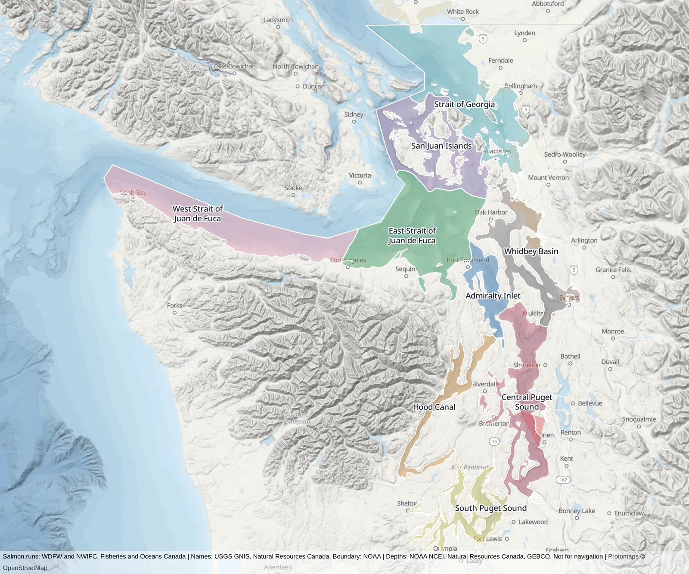
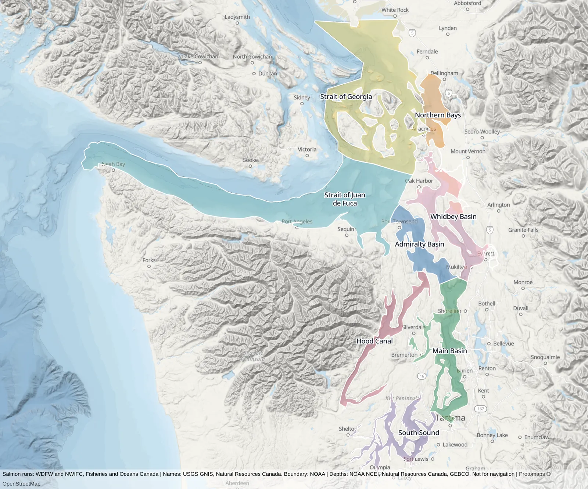
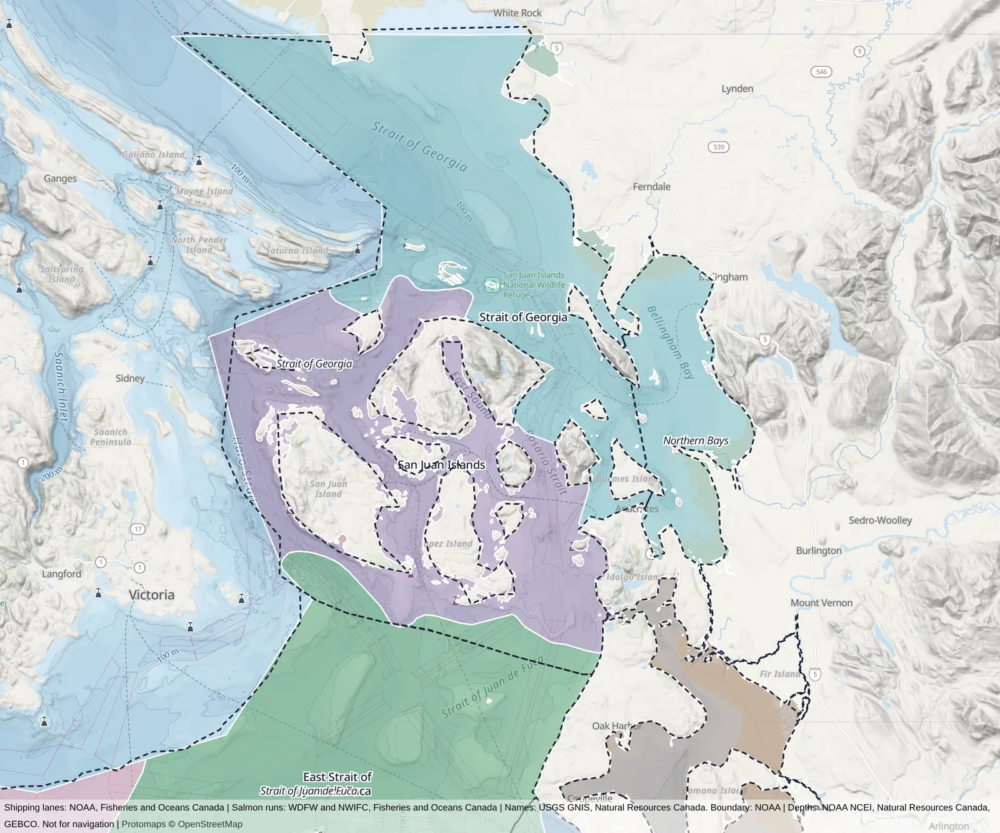
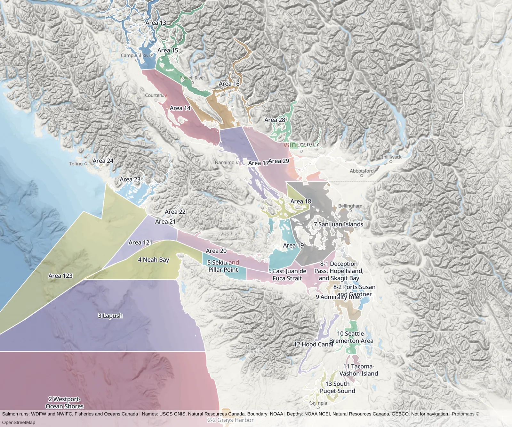

# How monitoring programs divide the Salish Sea, and which division SalishSea.io's sea areas should follow

**Research date:** 2026-10-27 · **Author:** research agent (AI-assisted), for Peter Abrahamsen · **Status:** background/reference; informs `salish-fwyt.2` (a sighting's place)

Follows [Open data for a watershed layer and a sea-area layer](watershed-and-sea-area-sources.md), which did not look at the Puget Sound Ecosystem Monitoring Program (PSEMP). Peter asked for this because SalishSea.io's subregions should align with what monitoring programs use, partly because SalishSea.io may bid on work with them.

"Verified" below means the agent read the owner's own page, report or data service. "Search summary" means I saw it only through a web search's summary and did not open the source.

## The short answer

- **The Puget Sound Ecosystem Monitoring Program (PSEMP) has no official map of marine regions.** Its annual Marine Waters report is a collection of short sections, each written by a contributing program, and each section uses that program's own basin names. No section publishes boundaries.
- **The closest thing PSEMP has to a partition is the basin set of the marine bird survey that the Washington Department of Fish and Wildlife (WDFW) flies for it.** WDFW publishes it as a map service named "PSEMP": nine named basins, each split into four depth bands, about 7,370 km² in all, which is roughly all of Washington's inland marine water. No licence is stated. Because Peter has contacts at WDFW, this is the easiest scheme to get permission for.
- **The US schemes agree on Puget Sound proper and disagree in the north.** Hood Canal, Whidbey Basin, South Sound and the Main (or Central) Basin come out the same in every scheme I tested. The San Juan Islands, Rosario Strait, Haro Strait and Bellingham Bay are where they part: Washington Ecology's Salish Sea Model basins put Haro and Rosario Straits in "Strait of Georgia" and the bays in "Northern Bays", while the WDFW bird survey puts the straits in "San Juan Islands" and the bays in "Strait of Georgia".
- **Every US scheme stops at the border, and Canada has no matching set of basins.** Fisheries and Oceans Canada (DFO) uses only very large bioregions (the whole Strait of Georgia is one) or numbered fishery subareas. Its annual state-of-the-ocean report, like PSEMP's, uses each contributor's own names. So the shared straits must be drawn by SalishSea.io, as the earlier survey already proposed.
- **Programs focused on Southern Resident killer whales divide the water for regulation, not for describing where whales are.** The exception is The Whale Museum's grid of 445 numbered squares, which NOAA republishes. Each square carries a Washington or Canadian fishing-area number, on both sides of the border.

## 1. What PSEMP uses

### The Marine Waters report

- **Where.** The current report (on 2025) is linked from PSEMP's [Marine Waters overview page](https://www.psp.wa.gov/PSEMP/PSmarinewatersoverview.php) through a Box share, with an archive of past reports (verified). The 2024 report is on the [Encyclopedia of Puget Sound](https://www.eopugetsound.org/article/puget-sound-marine-waters-2024-overview) as a [PDF](https://www.eopugetsound.org/sites/default/files/features/resources/2024_PSEMP_Marine_Waters_Report_FINAL.pdf) (verified; I read the whole text). The page says only that the report covers "the marine waters of greater Puget Sound" and the Washington coast.
- **What regions it names.** There is no single scheme and no map of regions. The contents are organised by program ("Central Basin long-term stations", "North Sound surveys", "Hood Canal moorings", "San Juan Channel/Juan de Fuca fall surveys"), and the names change from section to section:
  - The mooring network run by the University of Washington uses Hood Canal (north, mid and south), Main Basin, Admiralty Inlet and South Sound.
  - King County's long-term stations use Central Basin.
  - The ocean acidification cruises use Admiralty Reach, Main Basin, South Sound, Whidbey Basin and Hood Canal.
  - The shellfish biotoxin section uses North Sound, Central Sound and South Sound, plus Whidbey Basin, the Strait of Juan de Fuca and the coast.
  - The larval Dungeness crab section uses "northern", "central" and "southern Salish Sea" regions that cross the border.
  - The marine mammal and seabird section covers one survey line, in San Juan Channel and the Strait of Juan de Fuca.
- **Boundaries.** None are published. Licence: not applicable.

### Earlier PSEMP practice: six basins

The 2007 Puget Sound Update, from PSEMP's predecessor (the Puget Sound Ambient Monitoring Program), "delineated six main basins in Puget Sound" "to develop a common basis for monitoring and reporting": San Juan Archipelago, Strait of Juan de Fuca, North Puget Sound (Whidbey Basin and Admiralty Inlet), Central Puget Sound, Hood Canal and South Puget Sound. It adds that "in some basins, the boundaries coincide with sills; for others, the demarcation is arbitrary" ([Encyclopedia of Puget Sound page](https://www.eopugetsound.org/articles/2007-puget-sound-update), verified; the map is Figure 1-1 of the [report PDF](http://www.eopugetsound.org/sites/default/files/features/resources/PugetSoundUpdate2007Optimized.pdf), which I did not open). No GIS data was found.

### The marine bird survey's basins (WDFW)

- **What.** A WDFW map service named "PSEMP" and tagged "Marine Seabirds" ([service](https://geodataservices.wdfw.wa.gov/arcgis/rest/services/WP_WildlifeSurveys/PSEMP/MapServer/0), verified by querying it). It holds 36 polygons. Each is one of nine basins, in four depth bands labelled 0, 10, 20 and 50 (presumably depth in metres; the service doesn't say). These are the strata of the aerial surveys of wintering marine birds that WDFW has flown since the Puget Sound Ambient Monitoring Program, and the strata the PSEMP Marine Birds work group's data come from. The link to the survey's history is from a search summary only.

  | Basin (as spelled in the data) | Area |
  |---|---|
  | West Strait of Juan de Fuca | 1,134 km² |
  | East Strait of Juan de Fuca | 1,458 km² |
  | San Juan Islands | 792 km² |
  | Strait of Georgia (US waters only) | 1,367 km² |
  | Admirality Inlet [sic] | 327 km² |
  | Whidbey Basin | 649 km² |
  | Central Puget Sound | 852 km² |
  | South Puget Sound | 440 km² |
  | Hood Canal | 348 km² |

- **Coverage.** Washington waters only, from Cape Flattery (124.78°W) to Olympia, and north to the border at 49°N. Every water point I tested in US waters fell in a basin.
- **Licence.** Not stated. The item's licence field is empty, and its credit and copyright read "WDFW".

*The bird survey's nine basins. The service splits each basin into depth bands, which this picture merges. The fills look patchy close to shore because the bands don't reach every inlet. The service spells one basin "Admirality Inlet"; the map corrects it. The maps in this document are pictures drawn for it on 2026-10-27, over SalishSea.io's basemap, from the services cited; the boundary data itself is not kept in this repository.*

### Other work groups

PSEMP has ten active work groups: Diseases, Forage Fish and Food Webs, Marine Birds, Marine Mammals, Marine Waters, Nearshore, Salmonids, Spatial Data, Stormwater and Toxics (from a search summary of a [November 2025 PSEMP overview presentation](https://www.ezview.wa.gov/Portals/_1962/Documents/StormwaterWorkGroup/SWG%20PSEMP%20Overview%20Presentation%2011.12.25.pdf)). The Puget Sound Partnership's [2025 call for work-group coordinators](https://omwbe.wa.gov/node/24554) (verified; it closed 2025-04-30) named six of them: Forage Fish and Food Webs, Marine Birds, Marine Mammals, Marine Waters, Salmonids and Spatial Data. The same kind of contract may be the work SalishSea.io could bid on.

- **Spatial Data work group.** Its [ArcGIS Hub site](https://psemp-spatialdataworkgroup-wa-psp.hub.arcgis.com/) lists 31 items (verified through the site's search interface). It has data recommendations for zoning, wetlands, land cover, floodplains, levees, sea level rise, equity and marine shorelines, but **none for marine regions or basins**. No such standard exists yet; one could be proposed.
- **Marine Mammals work group.** I found no region scheme. A Navy-funded aerial survey reported to the group (Smultea and others, 2017) used "eight sub-regions of Puget Sound" ([project page](https://www.navymarinespeciesmonitoring.us/reading-room/project-profiles/aerial-surveys-marine-mammals-conducted-inland-puget-sound-waters-washington-summer-2013-winter-2016/), verified). The page doesn't name them, and I did not open the report.
- **Forage fish, toxics.** I did not find a region scheme of their own. WDFW's herring stocks are named for spawning grounds, not basins. Not checked further.

## 2. How these compare with Ecology's and the Puget Sound Partnership's divisions

### The divisions

- **Ecology's Salish Sea Model basins** ([service](https://gis.ecology.wa.gov/hosting/rest/services/Hosted/SSM_Basins/FeatureServer/89); it refuses requests without a browser user agent). Admiralty Basin, Hood Canal, Main Basin, Northern Bays, South Sound, Strait of Georgia, Strait of Juan de Fuca, Whidbey Basin. US waters only. The outlines are coarse and include land. No licence is stated.
- **Puget Sound Partnership Action Areas** ([item](https://www.arcgis.com/home/item.html?id=e87cd4a7dcea474080fb04cb91db7796), verified). Seven areas of land and water: Hood Canal, North Central Puget Sound, San Juan / Whatcom, South Central Puget Sound, South Puget Sound, Strait of Juan de Fuca, Whidbey. Licence field "None"; credit "Puget Sound Partnership, 2014". The Partnership has largely replaced them with the areas of its Local Integrating Organizations ([item](https://www.arcgis.com/home/item.html?id=5f8fa1e344ac473cb206e1d99ef5a612), licence "None"), which follow local politics.
- **The Puget Sound Nearshore Ecosystem Restoration Project's sub-basins**, republished by the Partnership ([item](https://www.arcgis.com/home/item.html?id=600cc7e57fa44da4a717f6816044fa45), verified). Seven: Whidbey, South Puget Sound, Strait of Juan de Fuca, Hood Canal, San Juan Islands and Georgia Strait, North Central Puget Sound, South Central Puget Sound. These are the same seven names as Ecology's "Oceanographic Subbasins" in the earlier survey. Land and water. No licence is stated.
- **The Partnership's Nearshore Basins**, derived from NOAA's salmon habitat monitoring ([item](https://www.arcgis.com/home/item.html?id=86ecddf86243496fbb880fc8cafc3e43)). Five: North Puget Sound, Strait of Juan de Fuca, Whidbey, Hood Canal, South Central Puget Sound. These are drawn around shorelines, for salmon populations.
- **The oceanographers' Puget Sound.** The Encyclopedia of Puget Sound defines it as Hood Canal, the Main Basin (Admiralty Inlet and the Central Basin), the South Basin and the Whidbey Basin ([article](https://www.eopugetsound.org/articles/geographic-boundaries-puget-sound-and-salish-sea); search summary only).

*Ecology's eight Salish Sea Model basins, in the same frame as the bird survey's above. It has one Strait of Juan de Fuca where the survey has two, and no San Juan Islands basin.*

### Where they agree and differ

I tested points in the water against each service. A dash means the point fell outside every polygon of that scheme, usually because the point is close to shore.

| Point | Ecology model basins | WDFW bird survey (PSEMP) | Partnership Action Area | Nearshore project sub-basin | WDFW catch area |
|---|---|---|---|---|---|
| Haro Strait (US side) | Strait of Georgia | San Juan Islands | San Juan / Whatcom | San Juan Islands and Georgia Strait | 7 |
| Rosario Strait | Strait of Georgia | San Juan Islands | Whidbey | San Juan Islands and Georgia Strait | 7 |
| Bellingham Bay | Northern Bays | Strait of Georgia | San Juan / Whatcom | San Juan Islands and Georgia Strait | 7 |
| Padilla Bay | Northern Bays | Strait of Georgia | Whidbey | San Juan Islands and Georgia Strait | 7 |
| Boundary Bay (US side) | Strait of Georgia | Strait of Georgia | San Juan / Whatcom | San Juan Islands and Georgia Strait | 7 |
| Dungeness | Strait of Juan de Fuca | East Strait of Juan de Fuca | Strait of Juan de Fuca | Strait of Juan de Fuca | 6 |
| Mid strait, 123.5°W | Strait of Juan de Fuca | West Strait of Juan de Fuca | Strait of Juan de Fuca | - | 6 |
| Port Townsend | Admiralty Basin | Admiralty Inlet | Hood Canal | North Central Puget Sound | 9 |
| Admiralty Inlet | Admiralty Basin | Admiralty Inlet | Whidbey | North Central Puget Sound | 9 |
| Possession Sound | Whidbey Basin | Whidbey Basin | Whidbey | South Central Puget Sound | 8-2 |
| Saratoga Passage | Whidbey Basin | Whidbey Basin | Whidbey | Whidbey | 8-2 |
| Skagit Bay | Whidbey Basin | Whidbey Basin | Whidbey | Whidbey | 8-1 |
| Off Seattle | Main Basin | Central Puget Sound | South Central Puget Sound | South Central Puget Sound | 10 |
| Tacoma Narrows | South Sound | South Puget Sound | North Central Puget Sound | South Central Puget Sound | 11 |
| Nisqually Reach | South Sound | South Puget Sound | South Puget Sound | South Puget Sound | 13 |
| Hood Canal | Hood Canal | Hood Canal | Hood Canal | Hood Canal | 12 |

- **The two science schemes, Ecology's model basins and WDFW's bird survey basins, agree everywhere south of the San Juan Islands.** One small exception: Ecology calls it "Main Basin" and WDFW "Central Puget Sound". In the north they disagree, as described in the short answer. WDFW also splits the Strait of Juan de Fuca in two, at about 123.4°W, just west of Port Angeles.
- **The Partnership's Action Areas are not a basin scheme for water.** Their lines follow counties and planning areas, so Admiralty Inlet comes out as "Whidbey", Port Townsend as "Hood Canal" and Tacoma Narrows as "North Central Puget Sound". The Nearshore project's sub-basins likewise put Possession Sound in "South Central Puget Sound". Neither suits a description of where a whale was.
- **WDFW's catch areas mostly nest within the bird survey's basins:** area 7 holds the San Juan Islands and the US Strait of Georgia, area 9 is Admiralty Inlet, 8-1 and 8-2 together are Whidbey Basin, area 12 is Hood Canal and area 13 is South Sound. The exceptions are 10 and 11, which divide Central Puget Sound along a different line than the bird survey's boundary with South Sound, and 5 and 6, which divide the strait at a different meridian. I did not compare the edges, only points.

*Where the two schemes differ, in the north. The fills are the bird survey's basins, and the dashed lines and italic names are Ecology's. Ecology's "Strait of Georgia" reaches south through the San Juans' channels, which the survey calls the San Juan Islands basin, and its "Northern Bays" takes Bellingham, Samish and Padilla Bays out of the survey's Strait of Georgia.*

## 3. The Canadian side

- **DFO's federal marine bioregions** ([open.canada.ca record](https://open.canada.ca/data/en/dataset/23eb8b56-dac8-4efc-be7c-b8fa11ba62e9), verified: [Open Government Licence – Canada](https://open.canada.ca/en/open-government-licence-canada)). These are the framework for Canada's network of marine protected areas, and they are coarse. The "Strait of Georgia" bioregion covers the strait, Boundary Pass and the inside waters. Canada's half of the Strait of Juan de Fuca, and, at the point I tested, Canada's side of Haro Strait, fall in the "Southern Shelf" bioregion with the west coast of Vancouver Island. The record says the boundaries "are fuzzy". Useful only as an outer frame.
- **DFO's annual state-of-the-ocean report** (*State of the physical, biological and selected fishery resources of Pacific Canadian marine ecosystems in 2025*, [PDF](https://publications.gc.ca/collections/collection_2026/mpo-dfo/fs97-6/Fs97-6-3797-eng.pdf), verified; I read the text). Like PSEMP's report, it is a collection of contributed sections, and each section uses its own regions. The recurring names are Juan de Fuca Strait, Haro Strait, Boundary Pass, the southern, central and northern Strait of Georgia (the oxygen section abbreviates the southern one "SoG-S"), "northern Salish Sea", Howe Sound and the Gulf Islands. The section on what Chinook salmon eat uses six regions: Gulf Islands/Haro Strait, Strait of Georgia, Howe Sound, Strait of Juan de Fuca, Barkley Sound and the west coast of Vancouver Island. The DFO cetacean survey covers "the southern Salish Sea and Swiftsure Bank", in Canadian waters only. No boundaries are published.
- **The regions of DFO's Institute of Ocean Sciences**, used for its Strait of Georgia zooplankton time series, are the "IOS regions" that the earlier survey found in Marine Regions' gazetteer (CC-BY): Juan de Fuca, Haro Strait, and the southern, central and northern Strait of Georgia, among others. They are the nearest thing to a Canadian basin set with outlines, but they are crude (about ten points each). That they underlie the zooplankton series is my reading of the report's section titles; I did not confirm it in the section text.
- **DFO's Pacific Fishery Management Areas and subareas.** This is what DFO actually manages by, including its measures to protect Southern Residents (below). Numbers, no names. No open licence, but the boundaries are in federal regulation and may be redrawn (see the earlier survey).
- **Pacific Salmon Foundation.** Its Citizen Science Oceanography program samples about 80 stations in nine local areas: Victoria, Cowichan Bay, Nanaimo/Qualicum, Baynes Sound, Campbell River, Lund, Powell River, Irvine's/Sechelt and Steveston (from a search summary of a [2015 presentation](https://dev.pices.int/publications/presentations/PICES-2015/2015-S10/S10-1210-Esenkulova.pdf)). These are groups of stations, not a partition of the water. I found no regions for the Salish Sea Marine Survival Project.
- **Salish Sea Ecosystem Conference.** I found no partition. Not checked further.

**Result: there is no Canadian equivalent of PSEMP's basins to line up with.** The names Canadian scientists use (Juan de Fuca Strait, Haro Strait, Boundary Pass, the southern, central and northern Strait of Georgia, Howe Sound, the Gulf Islands) are the same features that the Canadian geographical names database outlines under the Open Government Licence, as the earlier survey found.

*The fishing areas, the one division that covers both countries: WDFW's catch-record areas, numbered and named, in Washington, and DFO's Pacific Fishery Management Areas, numbered only, in British Columbia, merged here from their subareas. They meet at the border, so they partition the whole Salish Sea between them, but they are drawn for managing catch, and several of WDFW's names, such as "Seattle-Bremerton Area", are not places.*

## 4. Programs focused on Southern Resident killer whales

- **NOAA's critical habitat** ([50 CFR 226.206](https://www.ecfr.gov/current/title-50/chapter-II/subchapter-C/part-226/section-226.206), verified through eCFR's interface for programs). Three inland areas: the **Summer Core Area** (all US waters of Whatcom and San Juan counties, and Skagit County's west of the Deception Pass Bridge); the **Puget Sound Area** (east of a line from Point Wilson to Whidbey Island, but not Hood Canal); and the **Strait of Juan de Fuca Area** (east of the line from Cape Flattery to Bonilla Point). There are also six coastal areas from Cape Flattery to Point Sur. The lines follow counties, bridges and landmarks; Hood Canal is excluded; everything shallower than 20 feet (6.1 m) is left out. Being a federal regulation, the text is public domain. I could not reach NOAA's GIS service for the critical habitat, so I did not check its licence.
- **Canada's critical habitat** (DFO's [Critical Habitat for Aquatic Species at Risk](https://open.canada.ca/data/en/dataset/db177a8c-5d7d-49eb-8290-31e6a45d786c), verified: Open Government Licence – Canada). One polygon for the Southern Residents, 7,497 km², not subdivided. The recovery strategy calls it the "transboundary area" of Haro Strait, Boundary Pass and adjoining parts of the Strait of Georgia and the Strait of Juan de Fuca ([chapter 3](https://www.canada.ca/en/environment-climate-change/services/species-risk-public-registry/recovery-strategies/killer-whales/chapter-3.html), verified). Swiftsure and La Pérouse Banks were added in 2018 ([DFO announcement](https://www.canada.ca/en/fisheries-oceans/news/2018/12/government-of-canada-protects-two-new-areas-off-british-columbias-coast-for-resident-killer-whales.html); search summary only).
- **Canada's measures for 2026** ([Transport Canada bulletin 08/2026](https://tc.canada.ca/en/node/40077), verified). Vessel restricted zones off North Pender and Saturna Islands (formerly "interim sanctuary zones"), speed restricted zones on Swiftsure Bank, a voluntary slowdown zone in Tumbo Channel, and a 1,000 m approach rule south of Campbell River. The maps are "for visual representation only"; the bulletin gives no coordinates and no GIS data. DFO's fishery closures are written as fishery subareas (for example 18-2, 18-4, 18-5, 20-1, 21-0, 121-1 and 121-2; search summary only, because DFO's Pacific site did not resolve when I tried it).
- **The Whale Museum's quadrants**, republished by NOAA's West Coast Region ([InPort record](https://www.fisheries.noaa.gov/inport/item/72522), verified; [feature service](https://services2.arcgis.com/C8EMgrsFcRFL6LrL/arcgis/rest/services/TWM_SRKW_sightings_1990_2022/FeatureServer/0), queried). 445 numbered squares, clipped to the shore and cut where they cross a fishing-area line. They run from Olympia to about 49.5°N in the Strait of Georgia, and NOAA uses them to count Southern Resident sighting days for permitting. Each square carries a fishing-area code: Washington's 5 to 13 and Canada's 14, 17, 18, 19, 20, 28 and 29, each with a "C" suffix. **This is the one scheme in this field that crosses the border, and it does so by nesting inside the two countries' fishing areas.** No names. Licence: none stated, only NOAA's no-warranty disclaimer. The grid itself is The Whale Museum's.
- **Orca Network.** I found no reporting areas. Not checked further.

## Recommendation

**For US waters, follow the basins of the PSEMP marine bird survey, which WDFW publishes.** Use them as the coarse tier, with the names written out in full:

> Strait of Juan de Fuca (perhaps kept as east and west), San Juan Islands, Strait of Georgia (US part), Admiralty Inlet, Whidbey Basin, Central Puget Sound (Main Basin), South Puget Sound, Hood Canal.

Reasons:

- It is the only partition that a PSEMP program publishes as data.
- It agrees with Ecology's model basins wherever Ecology's lines are good, and it keeps "San Juan Islands" as a basin. That is the name Southern Resident observers use, and NOAA's Summer Core Area covers nearly the same water.
- It covers all of Washington's inland water.
- It nests closely with WDFW's catch areas and The Whale Museum's quadrants, so SalishSea.io's regions could be summed into either.
- The owner is WDFW, where Peter has contacts.

The named-feature tier from the earlier survey (Haro Strait, Rosario Strait, Saratoga Passage and so on) would sit inside these basins. Each feature takes the basin it mostly falls in.

**Treat the shared straits and Canada as one layer drawn by SalishSea.io, not as anyone's official basins.** Neither side has a cross-border set, so:

- Draw the Strait of Juan de Fuca and the Strait of Georgia as single shapes across the border, using the outlines in Canada's geographical names database. Then, if the US tier is kept, the US basins become their US parts. Otherwise mark the border inside each shape.
- Give Haro Strait and Boundary Pass a basin of their own, or fold them into "San Juan and Gulf Islands". The choice is the one place the US scheme has to be bent, because WDFW's "San Juan Islands" holds the US half of Haro Strait and Canada's critical habitat treats Haro Strait and Boundary Pass as one area.
- In Canada, split the Strait of Georgia into southern, central and northern parts, following the Institute of Ocean Sciences regions as a guide, and add Howe Sound and the Gulf Islands. These match the names in DFO's annual report.
- Record each region's DFO fishery area and WDFW catch area alongside it, so the regions can be summed into The Whale Museum's quadrants and DFO's closures.

**Whom to ask:**

- **WDFW (through Peter's contacts):**
  - May SalishSea.io republish the PSEMP marine bird strata (`WP_WildlifeSurveys/PSEMP`), and under what licence? No licence is stated.
  - Are those strata the basins the PSEMP Marine Birds work group considers its standard, and what do the depth labels 0, 10, 20 and 50 mean?
  - What licence covers the marine catch areas, or may SalishSea.io redraw them from WAC 220-311-010?
- **Washington Ecology (no contact yet):** What licence covers the Salish Sea Model basins? Does Ecology's marine monitoring group stations by them? This matters less if the WDFW basins are chosen, because Ecology's would then be only a check.
- **Puget Sound Partnership, through PSEMP's Spatial Data work group (its Hub site has a feedback form):** Would PSEMP adopt a common marine-basin layer? None exists among its data recommendations, so offering to make one could be part of a bid. The Action Areas and Local Integrating Organization areas need no permission, because they aren't recommended for this use.
- **The Whale Museum, and NOAA's West Coast Region, which republishes the grid:** Only if SalishSea.io wants to use or show the quadrants. No licence is stated.
- **Fisheries and Oceans Canada:** Nothing to ask for the bioregions or the critical habitat, which are under the Open Government Licence – Canada. Ask only if SalishSea.io wants DFO's file of fishery subareas rather than redrawing them from the regulation.

## What I could not verify

- The names of the Navy survey's eight Puget Sound sub-regions.
- What the WDFW strata's depth labels mean, and whether they are the current survey's strata or an older set.
- NOAA's GIS service for critical habitat (it refused my requests), and so its licence statement.
- DFO's Pacific pages on its Southern Resident measures (the host did not resolve).
- Whether Ecology's marine monitoring program has a station-to-basin list of its own.
- The Salish Sea Ecosystem Conference, Orca Network and the Salish Sea Marine Survival Project. I found nothing that divides the water, but I searched only briefly.
